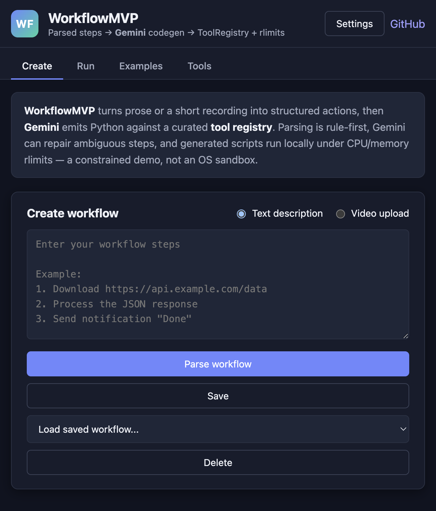
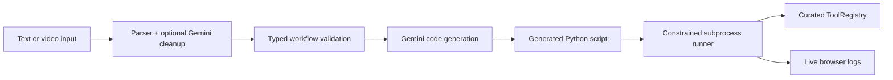

# WorkflowMVP

[](https://github.com/KMeltzer24/workflowMVP/actions/workflows/ci.yml)
[](#requirements)
[](LICENSE)

WorkflowMVP is a local Flask demo that turns numbered prose, or a short screen recording, into a Python script wired to a curated `ToolRegistry`.

It is an AI-engineering sample, not a hosted automation platform. Rule-based parsing, optional Gemini cleanup, typed step validation, Gemini code generation, subprocess rlimits, live run logs, and an AST import policy all sit in front of **trusted local execution**. Generated Python is still a process on your machine.

## What It Does

1. Describe a workflow in numbered steps, or upload a screen recording.
2. Parse the workflow into structured actions.
3. Generate Python that calls built-in tools instead of inventing I/O from scratch.
4. Run that script from the browser.
5. Stream stdout/stderr through Server-Sent Events.



The UI is vanilla JavaScript split by tab (`web/static/js/core.js`, `create-tab.js`, `run-tab.js`, `examples-tab.js`, `tools-tab.js`, `app.js`) with no bundler.

Example:

```text
1. Download https://api.coinbase.com/v2/prices/BTC-USD/spot
2. Write the Bitcoin USD price to file "bitcoin_price.txt"
3. Send notification with title "Bitcoin" and message "Price saved"
```

## Design

The interesting part is the boundary between the model and the runtime:

- numbered text (or video frames) becomes structured steps
- a planner decides when Gemini should repair a weak parse
- typed validation rejects unknown actions and missing required parameters
- codegen emits Python against a fixed tool list
- a subprocess runs that file with CPU/RSS/file-size rlimits, a per-run working directory, and log redaction



Key paths:

- `main.py` — CLI (`python main.py`). Signal handlers and cleanup register here only.
- `workflowmvp/app.py` — `create_app()`; gunicorn target is `workflowmvp.app:app`.
- `workflowmvp/blueprints/` — HTTP routes (pages, tools/examples, parse/video, generate, run).
- `workflowmvp/parser.py` — rule-first parser for numbered/bulleted steps.
- `workflowmvp/services/workflow_planning.py` — shared text/video planning boundary.
- `workflowmvp/services/workflow_validation.py` — step shape, required params, allowed actions.
- `workflowmvp/agent.py` — Gemini cleanup and code generation.
- `workflowmvp/services/code_policy.py` — AST import/call policy on generated scripts.
- `workflowmvp/tools/` — built-in registry used by generated scripts.
- `web/` — workspace UI (steps, generated Python, live run) plus Examples and Tools tabs.
- `examples/` — sample CSV and recordings.
- `tests/` — pytest for parser, tools, API, codegen validation, and video framing.

## Tool System

Generated scripts call `ToolRegistry` instead of inventing file, network, email, and parsing logic. The registry currently exposes 30 built-in tools:

| Category | Tools | What they do |
| --- | --- | --- |
| Files | `read_file`, `write_file`, `append_file`, `list_files`, `create_directory`, `copy_file`, `move_file`, `delete_file` | File and directory operations inside the per-run output directory. |
| Structured files | `read_csv`, `write_csv`, `read_json`, `write_json`, `read_xlsx`, `write_xlsx`, `read_pdf` | Common data formats and PDF text. |
| Network | `download`, `http_request`, `scrape_webpage`, `discover_urls` | Public HTTP fetch, APIs, readable page text, same-site URL discovery. |
| AI and templates | `generate_text`, `render_template` | Gemini text or Jinja2 templates. |
| Communication | `send_email`, `send_notification` | SMTP email or local desktop notifications. |
| Data and finance | `sqlite_query`, `sqlite_insert`, `fetch_stock_price` | Local SQLite and recent market prices. |
| Time and archives | `wait`, `get_current_time`, `compress_files`, `extract_archive` | Timing, timestamps, ZIP create/extract. |

Normalized tool envelope:

```python
{
    "success": True,
    "result": "...",
    "error": None,
    "meta": {"tool": "download"}
}
```

Prefer `result` and `meta`. Older keys such as `content` or `data` may still appear.

```python
tools = ToolRegistry()
read_json = tools.get_tool("read_json")
response = read_json.function(file_path="data.json")

if response["success"]:
    payload = response["result"]
else:
    print(response["error"])
```

## Planning Flow

1. Text is parsed by the rule-first parser.
2. Video is sampled into key frames, summarized by Gemini vision, then parsed by the same parser.
3. Missing required parameters or low confidence can trigger one Gemini cleanup pass.
4. Steps must pass typed validation before code generation.
5. Codegen receives structured steps, not raw prose.

## Demo Assets

- `examples/inputs/tickets.csv` — sample ticket data for the file-processing video.
- `examples/videos/BitcoinEmailTest.mp4` — Bitcoin price/email recording.
- `examples/videos/DataFileTest.mp4` — local CSV filtering recording.

## Requirements

- Python 3.11+
- A Google Gemini API key for cleanup, code generation, and video analysis

The rule parser can draft simple text steps without Gemini. End-to-end generation and video analysis need `GEMINI_API_KEY`.

Create a key in [Google AI Studio](https://aistudio.google.com/apikey).

## Setup

```bash
git clone https://github.com/KMeltzer24/workflowMVP.git
cd workflowMVP

python3.11 -m venv .venv
source .venv/bin/activate

pip install ".[dev]"

cp .env.example .env
```

If you do not have `python3.11`, use any 3.11+ interpreter (`python3`).

```bash
GEMINI_API_KEY=your_key_here
GEMINI_MODEL=gemini-3.5-flash-lite
```

`GEMINI_MODEL` is optional and defaults to `gemini-3.5-flash-lite` (cost-efficient Flash-Lite with vision). For higher-quality codegen, set `GEMINI_MODEL=gemini-3.8-flash`. Prefer `.env` for local work; the Settings modal is a per-request override for demos.

SMTP is optional and only needed for `send_email`. For Gmail, use an app password as `EMAIL_PASSWORD`.

## Run Locally

```bash
make run
```

Open `http://127.0.0.1:5050`.

```bash
python main.py --port 5001 --debug
```

## Development

```bash
make test    # pytest with an 80% coverage floor on workflowmvp
make lint    # ruff + mypy
make format
```

Equivalent:

```bash
.venv/bin/python -m pytest
.venv/bin/ruff check .
.venv/bin/mypy workflowmvp
```

```bash
.venv/bin/python -m build
make clean
```

CI (`.github/workflows/ci.yml`) runs ruff, mypy, and pytest on Python 3.11 and 3.12.

## Docker (optional)

The image binds gunicorn to `0.0.0.0:5050`. Treat that like exposing the app on the host network: anyone who can reach the port can generate and run Python as the container user.

```bash
docker build -t workflowmvp .
docker run --rm -p 127.0.0.1:5050:5050 --env-file .env workflowmvp
```

Demo videos are excluded from the image (`.dockerignore`). Sample CSV input is included.

## Contributing

This is a personal demo repo. Useful PRs: tests, tool-contract bugs, docs that match the code. Run `make lint` and `make test` before opening a PR. Do not commit `.env`, API keys, or generated files under `data/`.

## Environment Variables

Secrets (also listed in `.env.example`):

```bash
GEMINI_API_KEY=...
GEMINI_MODEL=gemini-3.5-flash-lite  # optional; gemini-3.8-flash for stronger codegen

EMAIL_USER=...
EMAIL_PASSWORD=...
EMAIL_FROM=...
SMTP_SERVER=smtp.gmail.com
SMTP_PORT=587
```

Server and safety (defaults shown):

```bash
HOST=127.0.0.1
PORT=5050
WORKFLOW_MAX_UPLOAD_MB=100
WORKFLOW_SAFETY_PROFILE=safe          # safe | full (full registers run_command)
WORKFLOW_RLIMIT_CPU=120               # subprocess CPU seconds
WORKFLOW_RLIMIT_AS_MB=1024            # address-space cap
WORKFLOW_RLIMIT_FSIZE_MB=100          # max file size written by the child
WORKFLOW_DISABLE_RLIMIT=0             # 1 disables POSIX rlimits
WORKFLOW_ENABLE_BLOCKING_RUN_ENDPOINT=0
WORKFLOW_HTTP_CONNECT_TIMEOUT=8
```

## Limitations

- Bind to localhost unless you trust everyone on the network. Anyone who can POST can generate and run Python as your user.
- File tools stay under `WORKFLOW_OUTPUT_DIR` (the per-run directory). Raw `open()` in generated code does not.
- Network tools block localhost, private, link-local, and metadata addresses, including redirect hops. `yfinance` and other allowed imports can still reach the public internet.
- There is no OS jail, seccomp, or RestrictedPython. Constraints are rlimits, path checks on tools, URL policy, and an AST import/call denylist.
- Gemini is required for codegen, video, and ambiguous-step cleanup.

## Security

Treat this as a local demo:

- Do not expose `--host 0.0.0.0` or the Docker bind on an untrusted network.
- Credentials in Settings live in `sessionStorage` and are sent on API requests; `.env` is the durable store.
- Run logs redact known secret values (`GEMINI_API_KEY`, `EMAIL_PASSWORD`) before they return to the UI.
- Shell (`run_command`) is off unless `WORKFLOW_SAFETY_PROFILE=full`.

## License

MIT. See [LICENSE](LICENSE).
