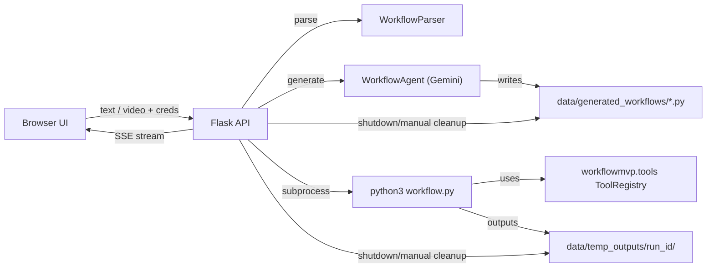

# WorkflowMVP

[](https://github.com/KMeltzer24/workflowMVP/actions/workflows/ci.yml)
[](#install)
[](#license)

Turn natural-language descriptions — or screen-capture videos — into runnable Python workflows.

WorkflowMVP uses Google's Gemini model to parse workflow descriptions into structured steps, generate clean Python using a built-in tool registry (file I/O, HTTP, CSV/JSON, SQLite, email, compression, …), and runs them in a sandboxed directory with live output streamed back to the browser.

---

## Highlights

- Text workflows or screen-recording videos → executable Python.
- 20+ built-in tools: files, CSV/JSON, HTTP, SQLite, compression, email, notifications, subprocess.
- Browser UI with tabs, dark-mode-aware styling, and live (SSE) run output.
- Credentials in **Settings** (stored only in your browser's `sessionStorage`) or `.env` — never written to disk server-side.
- Runs are sandboxed under `data/temp_outputs/<run_id>/` and cleaned up on server shutdown (or via `/api/cleanup`).
- Hybrid parsing: deterministic parser first, optional AI assist only for low-confidence parses.
- Tool safety profile: sandboxed paths + blocked shell commands in default safe mode.
- Pytest suite + GitHub Actions CI (ruff + pytest on Python 3.9 & 3.11).

## Architecture



## Install

Requires Python 3.9+.

```bash
git clone https://github.com/KMeltzer24/workflowMVP.git
cd workflowMVP
pip install -r requirements.txt
cp .env.example .env        # optional – credentials can be set via the UI
```

Grab a Gemini API key from [Google AI Studio](https://makersuite.google.com/app/apikey) and put it in `.env` or enter it later via the Settings modal in the web UI.

## Run

```bash
python3 main.py                       # production mode (default port 5050)
python3 main.py --debug               # Flask debug + auto-reload
python3 main.py --port 5001           # pick a different port
PORT=5001 python3 main.py             # via environment variable
```

Then open <http://localhost:5050> (or whichever port you picked).

> **macOS note:** the default port is 5050 because macOS AirPlay Receiver claims port 5000. If you'd rather free up 5000, disable AirPlay Receiver under **System Settings → General → AirDrop & Handoff**.

### Makefile shortcuts

```bash
make install   # runtime deps
make dev       # dev deps (pytest, ruff)
make run       # start the web UI
make test      # run the test suite
make lint      # ruff check
make clean     # wipe generated scripts + temp outputs
```

## Using the web UI

1. **Create** tab — write a numbered workflow or upload a screen-capture video; click *Parse*. Edit any parsed step inline before generating code.
2. **Generate Python code** — sends the steps to Gemini and writes a script into `data/generated_workflows/`.
3. **Run** tab — executes the generated script in an isolated `data/temp_outputs/<run_id>/` directory. Output streams live via Server-Sent Events. Artifacts persist during the server session and are removed on shutdown (or via `/api/cleanup`).
4. **Examples** tab — four self-contained examples (one requires SMTP credentials to demonstrate the inline creds prompt).
5. **Tools** tab — browse every tool exposed to generated code.
6. **Settings** (top right) — enter your Gemini key / SMTP credentials. Values live only in browser `sessionStorage` and are sent per-request; clear them with one click.

## Example workflow

```
1. Write the text "name,age\nAlice,30\nBob,25\nCarol,41\nDan,29" to file "users.csv"
2. Read the CSV file "users.csv"
3. Calculate the average age of users
4. Write a summary to file "report.txt"
5. Send notification with title "Pipeline" and message "Report generated"
```

Paste it into the Create tab, click *Parse workflow*, then *Generate Python code*, then *Run*. Outputs land in `data/temp_outputs/<run_id>/` and persist until shutdown/manual cleanup.

## API

| Method | Path | Purpose |
|---|---|---|
| `GET`  | `/api/tools` | List available tools + parameters. |
| `GET`  | `/api/examples` | Built-in example workflows (with `requires_credentials`). |
| `POST` | `/api/parse-workflow` | Parse numbered text into steps. |
| `POST` | `/api/parse-video` | Extract steps from an uploaded video (multipart). |
| `POST` | `/api/generate-workflow` | Generate a Python script from parsed steps. |
| `POST` | `/api/check-requirements` | Report which env vars the run will need. |
| `POST` | `/api/run-workflow` | Run a generated workflow (blocking). |
| `POST` | `/api/run-workflow/stream` | Run and stream stdout via SSE. |
| `POST` | `/api/cleanup` | Wipe generated scripts + temp outputs. |

Every POST endpoint accepts a `credentials` object in the body; values are injected into the subprocess environment and never written to disk.

## Development

```bash
pip install -r requirements-dev.txt
pytest          # unit + API + end-to-end tests
ruff check .    # lint
```

### Project layout

```
workflowMVP/
├── main.py                 # Flask app, subprocess runner, SSE streaming, cleanup
├── cleanup.py              # cleanup_files() for generated + temp outputs
├── workflowmvp/
│   ├── parser.py           # numbered-text -> structured steps
│   ├── agent.py            # Gemini-backed code generator
│   ├── tools.py            # ToolRegistry (20+ tools)
│   └── video_to_workflow.py# frame sampling + Gemini vision analysis
├── web/
│   ├── templates/index.html
│   └── static/
│       ├── css/style.css
│       └── js/app.js
├── tests/                  # pytest suites
├── .github/workflows/ci.yml
├── pyproject.toml
├── Makefile
└── .env.example
```

### Extending the tool registry

```python
from workflowmvp.tools import Tool, ToolRegistry

def my_tool(param: str) -> dict:
    return {"success": True, "result": param.upper()}

registry = ToolRegistry()
registry.register_tool(
    Tool(
        name="shout",
        description="Uppercase a string.",
        function=my_tool,
        parameters={"param": "String to uppercase"},
    )
)
```

## Troubleshooting

- **"Missing GEMINI_API_KEY"** — open *Settings* or add `GEMINI_API_KEY=...` to `.env`.
- **Email run fails with "Missing SMTP credentials"** — click *Settings* and fill in `EMAIL_USER`, `EMAIL_PASSWORD`, `EMAIL_FROM`. For Gmail, use an [App Password](https://myaccount.google.com/apppasswords).
- **Video parse returns no steps** — re-record with slower, clearer UI interactions or boost `max_frames` in `workflowmvp/video_to_workflow.py`.
- **"Workflow file not found"** — verify the path still exists under `data/generated_workflows/`; artifacts are removed on shutdown/cleanup.

## License

MIT — see [LICENSE](LICENSE) (add one if missing).

## Acknowledgements

- [Google Gemini](https://ai.google.dev/) for text + vision generation.
- [Flask](https://flask.palletsprojects.com/) for the web server.
- [OpenCV](https://opencv.org/) for frame sampling.
