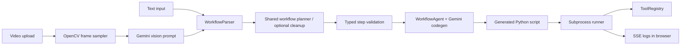

# WorkflowMVP

[](https://github.com/KMeltzer24/workflowMVP/actions/workflows/ci.yml)
[](#requirements)
[](#license)

WorkflowMVP is a Flask application that turns plain-English workflow descriptions, or a short screen recording, into runnable Python automation scripts.

The project is designed as a practical AI engineering demo: it combines rule-based parsing, optional Gemini cleanup for ambiguous steps, Gemini code generation, a constrained tool system, subprocess execution, live run logs, and safety checks around generated code.

## What It Does

Users can:

1. Describe a workflow in numbered steps, or upload a screen recording.
2. Parse the workflow into structured actions.
3. Generate Python code from those actions.
4. Run the generated workflow from the browser.
5. Stream stdout/stderr logs live through Server-Sent Events.

Example workflow:

```text
1. Download https://api.coinbase.com/v2/prices/BTC-USD/spot
2. Write the Bitcoin USD price to file "bitcoin_price.txt"
3. Send notification with title "Bitcoin" and message "Price saved"
```

## Core Architecture



Key components:

- `main.py` - Flask routes, UI endpoints, workflow generation, and run streaming.
- `workflowmvp/parser.py` - rule-first parser that creates rough structured workflow steps.
- `workflowmvp/services/workflow_planning.py` - shared planning boundary that decides when rough text/video steps need Gemini cleanup before code generation.
- `workflowmvp/services/workflow_validation.py` - typed validation layer for step shape, required params, allowed actions, dependencies, and side-effecting tools.
- `workflowmvp/agent.py` - Gemini-backed step cleanup and code generator for runnable Python workflows.
- `workflowmvp/services/` - runner, credentials, cleanup, path safety, static analysis, planning, and validation helpers.
- `workflowmvp/tools/` - built-in tool registry used by generated scripts.
- `workflowmvp/prompts/` - versioned prompt templates for LLM workflows.
- `web/` - browser UI for creating, generating, and running workflows.
- `tests/` - pytest coverage for parser, tools, API routes, generated-code validation, and video flow.

## Tool System

The tool system is the main design feature. Generated scripts call a curated `ToolRegistry` instead of inventing file, network, email, database, and parsing logic from scratch. This keeps AI-generated code smaller, safer, and easier to test.

The registry currently exposes 34 built-in tools:

| Category | Tools | What They Do |
| --- | --- | --- |
| Files | `read_file`, `write_file`, `append_file`, `list_files`, `create_directory`, `copy_file`, `move_file`, `delete_file`, `hash_file` | Basic sandboxed file and directory operations. |
| Structured files | `read_csv`, `write_csv`, `read_json`, `write_json`, `read_xlsx`, `write_xlsx`, `read_pdf` | Read/write common data formats and extract PDF text. |
| Network | `download`, `http_request`, `scrape_webpage`, `discover_urls` | Fetch public HTTP content, call APIs, scrape readable page text, and discover same-site URLs. |
| AI and templates | `generate_text`, `render_template` | Generate Gemini text output or render deterministic Jinja2 templates. |
| Text processing | `extract_regex`, `replace_text`, `split_text` | Perform deterministic text extraction and transformation without another LLM call. |
| Communication | `send_email`, `send_notification` | Send SMTP email or local desktop notifications. |
| Data and finance | `sqlite_query`, `sqlite_insert`, `fetch_stock_price` | Work with local SQLite databases and retrieve recent market prices. |
| Time and archives | `wait`, `get_current_time`, `compress_files`, `extract_archive` | Handle timing, timestamps, ZIP creation, and ZIP extraction. |

Each tool returns a normalized response envelope:

```python
{
    "success": True,
    "result": "...",
    "error": None,
    "meta": {"tool": "download"}
}
```

`result` is the primary output. `meta` stores details such as file paths, row counts, status codes, URLs, sheet names, or tool names. Older compatibility fields like `content`, `data`, `message`, `files`, or `rows` may still be present, but new generated code should prefer `result` and `meta`.

Example generated-code usage:

```python
tools = ToolRegistry()
read_json = tools.get_tool("read_json")
response = read_json.function(file_path="data.json")

if response["success"]:
    payload = response["result"]
else:
    print(response["error"])
```

The registry also includes practical safety controls:

- Generated workflows run in per-run output directories.
- File tools enforce sandbox path boundaries during runs.
- Network tools block localhost, private IPs, metadata IPs, and non-HTTP schemes.
- Side-effecting tools such as email, file writes, HTTP requests, SQLite writes, and archive extraction are surfaced during workflow validation.
- Credential-aware tools advertise required settings such as `GEMINI_API_KEY` or SMTP variables.
- Shell execution is disabled by default and only appears when `WORKFLOW_SAFETY_PROFILE=full`.
- Run logs redact known secret values before returning stdout/stderr to the UI.
- Generated code is compiled and checked against known tool-contract mistakes before saving.

From an engineering perspective, the registry is intentionally simple: each tool is a small Python function wrapped by a shared response normalizer, with tests covering safety rules, parsing contracts, and common success/failure paths.

## Planning Flow

Text and video inputs intentionally converge before code generation:

1. Text input is parsed directly by the rule-first parser.
2. Video input is sampled into key frames, summarized into rough numbered steps by Gemini vision, then parsed by the same rule-first parser.
3. The shared planner checks parse quality. Missing required parameters and low-confidence parses can trigger one Gemini cleanup pass; usable rule-first parses continue without the extra LLM call.
4. Cleaned-up steps must pass typed validation before code generation.
5. Code generation receives structured, validated steps instead of vague prose.

This keeps the rule parser small and predictable while using the LLM where it is strongest: interpreting ambiguous user intent and normalizing it into concrete tool calls.

## Why This Project Matters

This project demonstrates junior SWE skills that are useful on real teams:

- building a full-stack Python web app
- designing service boundaries around risky operations
- writing tests for API routes, tools, parsing, and safety behavior
- integrating LLMs without letting prompts become the whole system
- using typed validation at the boundary between browser JSON and code generation
- packaging Python code correctly with subpackages and prompt data
- maintaining CI with `pytest` and `ruff`

## Requirements

- Python 3.11+
- Google Gemini API key for workflow cleanup, code generation, and video analysis

The rule parser can draft simple text steps without Gemini, but the end-to-end
app requires `GEMINI_API_KEY`: ambiguous step cleanup, generated Python, and
video-to-workflow analysis all use Gemini.

Create a Gemini API key in [Google AI Studio](https://aistudio.google.com/apikey).

## Setup

```bash
git clone https://github.com/KMeltzer24/workflowMVP.git
cd workflowMVP

python3.11 -m venv .venv
source .venv/bin/activate

pip install ".[dev]"

cp .env.example .env
```

If your system does not have a `python3.11` command, use any Python 3.11+
interpreter available on your machine, such as `python3`.

Add your Gemini key to `.env`:

```bash
GEMINI_API_KEY=your_key_here
GEMINI_MODEL=gemini-2.5-flash
```

`GEMINI_MODEL` is optional. If unset, WorkflowMVP uses `gemini-2.5-flash`.
For regular local development, prefer `.env`; the browser Settings modal is a per-request convenience for demos, testing, or temporarily overriding `.env` values.

SMTP settings are optional and only needed for workflows that send email. For
Gmail, enable two-factor authentication and use an app password as
`EMAIL_PASSWORD`.

## Run Locally

```bash
make run
```

Open:

```text
http://127.0.0.1:5050
```

Alternative:

```bash
python main.py --port 5001 --debug
```

## Development

Run tests and lint:

```bash
.venv/bin/python -m pytest
.venv/bin/ruff check .
```

Build the package:

```bash
.venv/bin/python -m build
```

Clean generated artifacts:

```bash
make clean
```

## Environment Variables

Common variables:

```bash
GEMINI_API_KEY=...
GEMINI_MODEL=gemini-2.5-flash  # optional; default when unset

EMAIL_USER=...
EMAIL_PASSWORD=...
EMAIL_FROM=...
SMTP_SERVER=smtp.gmail.com
SMTP_PORT=587
```

Server defaults:

```bash
HOST=127.0.0.1
PORT=5050
WORKFLOW_MAX_UPLOAD_MB=100
```

## Notes

WorkflowMVP runs generated Python on the server host. The project includes several guardrails, but it is intended as a local portfolio/demo app, not a multi-tenant production automation platform.

## License

MIT
