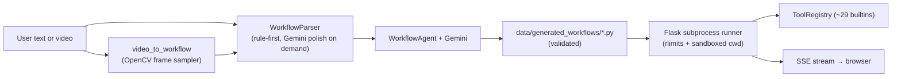

# WorkflowMVP

[](https://github.com/KMeltzer24/workflowMVP/actions/workflows/ci.yml)
[](#requirements)
[](#license)

**Portfolio-sized demo:** turns numbered English steps (optionally a screen recording into text first) **into runnable Python** that drives a curated built-in **`ToolRegistry`**. A Flask UI runs **rule-first parsing**, optional **Gemini-assisted** JSON repair when the parser is unsure, **`WorkflowAgent`** **code generation** on **Google Gemini**, and **sandboxed execution** with **SSE logs**. Fits a résumé line: *Natural-language workflows → Gemini codegen over a constrained tool API.*



## Requirements

- **Python 3.11+** (macOS system `/usr/bin/python3` is often older — use Homebrew/pyenv.)

## Setup

```bash
git clone https://github.com/KMeltzer24/workflowMVP.git
cd workflowMVP
python3.11 -m venv .venv && source .venv/bin/activate
pip install -r requirements.txt
cp .env.example .env      # then add GEMINI_API_KEY (and optional SMTP vars)
make run                  # → http://127.0.0.1:5050
```

## Environment

**Gemini** powers codegen, optional parse improvement, **`generate_*` tools**, and **video→text** framing. Minimal `.env`:

```bash
GEMINI_API_KEY=...
# Optional — defaults to gemini-2.5-flash inside the client
GEMINI_MODEL=gemini-2.5-flash
```

Add **SMTP** keys only when you run workflows that call `send_email`.

## Run

```bash
make run
python main.py --port 5001 --debug
```

## What it showcases

- **Parse** — Structured steps from prose; optional Gemini JSON pass when confidence is low.
- **Generate** — Steps → validated Python under `data/generated_workflows/` (`workflowmvp/agent.py` + Gemini).
- **Run** — Subprocess under `data/temp_outputs/<run_id>/`, resource limits (`workflowmvp/services/runner.py`), stdout via SSE.
- **UI** — Create / Run / Examples / Tools; secrets in **`sessionStorage`** for the browser session (`GEMINI_*`, SMTP) — merged with `.env` on the server, not persisted as plaintext snapshot files beyond normal env semantics.
- **CI** — `ruff` + `pytest --cov` on Python **3.11** and **3.12**.

## Using the UI (short)

1. **Create** — Describe steps or upload video → **Parse workflow** → edit lines; Save re-parses that step.
2. **Generate Python code** — Writes a script under `data/generated_workflows/`; the **Run** tab shows **generation time**.
3. **Run** — Streamed subprocess log; artifacts under `temp_outputs` until cleanup.
4. **Settings** — Gemini + SMTP as needed.

Prefer **explicit URLs** in step text when timing matters; otherwise codegen may **`discover_urls`** (sitemap + same-origin links) before **`scrape_webpage`** — not a crawler.

## Deployment (minimal)

Runs **generated code on the server host**. Default bind **`127.0.0.1`**, upload cap **100 MB**.

```bash
pip install -r requirements.txt gunicorn
HOST=127.0.0.1 PORT=5050 gunicorn --workers 2 --timeout 180 workflowmvp.app:app
```

Use TLS at the edge. See **[CHANGELOG.md](CHANGELOG.md)** for release notes.

## Development

```bash
pip install -r requirements-dev.txt
pytest && ruff check .
make clean   # temp outputs + local caches (see Makefile)
```

**Layout:** `main.py` routes + CLI; **`workflowmvp/`** parser, agent, `llm`, `tools/`, `tool_contracts`, `services/`, **`json_llm`** (robust extraction of JSON from model prose); **`web/`** static + templates; **`tests/`** pytest.

## Troubleshooting

| Issue | Hint |
|--------|------|
| Missing API key | `GEMINI_API_KEY` in `.env` or Settings. |
| Email SMTP | Gmail [App Password](https://myaccount.google.com/apppasswords) or your provider vars. |
| Video → thin steps | Clearer recording; tune sampling in `video_to_workflow.py`. |

## License

MIT

## Credits

Google Gemini · Flask · OpenCV · yfinance (see `requirements.txt` / `pyproject.toml` pins).
